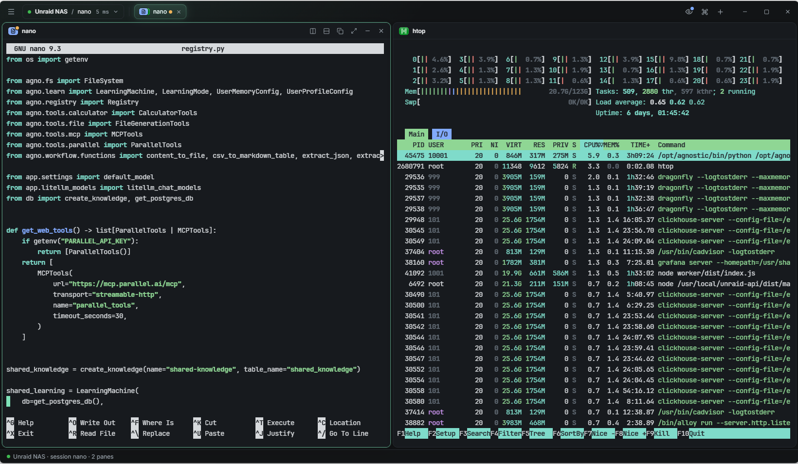

# Lume

A cross-platform terminal with a focus on modularity and Rex server support

Lume is a terminal built on [libghostty](https://github.com/ghostty-org/ghostty) and WebGPU. It
keeps the core small and lets you shape the rest: your own plugins, your own layout of tabs, panes
and panels, and, if you use one, sessions that live on a [Rex](https://www.superlogical.com/)
server.



> [!NOTE]
> Lume is an unofficial, third-party client of the Rex server. It is not made, endorsed or
> supported by [Superlogical](https://www.superlogical.com/), and uses none of the Rex or
> Superlogical logos and icons. It started as a place to experiment and to cover my own needs.
>
> Rex is in early access: you need to sign up for the beta and install its latest binaries, and you
> should expect breaking changes along the way.

## Features

- The application and its core libraries are written in Rust. The terminal is
  built with WebGPU and WebGL / Canvas 2D fallbacks where is it possible
- An ability to run in a standalone mode and/or with [Rex server](https://www.superlogical.com/) (optional): on this
  computer, over SSH or over HTTPS. `lume --rex [server]` starts on one
- No built-in coding agents or other tools: a user decides what to use
- Supports plugins in TypeScript / JavaScript
- Supports Windows, Linux and macOS

## Development

Lume is built from source for now. You will need:

- [Rust](https://www.rust-lang.org/tools/install) 1.100 or later
- [Node.js](https://nodejs.org/) 24.11.0 or later

Everything else (the pinned Zig toolchain, libghostty-vt, JavaScript dependencies) is fetched by the
project's own build tool, `cargo xtask`:

```sh
cargo xtask setup   # fetch the pinned tools and libghostty-vt, install JS dependencies
cargo xtask build   # build the terminal engine, the UI and the application
cargo xtask dev     # run Lume with hot reload
```

To check what your system's webview supports, run `target/debug/lume-gui --probe`. It prints a JSON
report and exits.

## Working on Lume

These are the commands you will reach for most often. `cargo xtask` with no arguments lists them
all.

| Command               | What it does                                                          |
| --------------------- | --------------------------------------------------------------------- |
| `cargo xtask test`    | Run the Rust and JavaScript tests                                     |
| `cargo xtask lint`    | Check formatting, run clippy, licence checks and the JS linters       |
| `cargo xtask e2e`     | Run the suites that need a real window, including the UI scenes       |
| `cargo xtask bench`   | Measure performance against the budgets in `tests/bench`              |
| `cargo xtask dist`    | Build release packages (add `--installers` for installers)            |
| `cargo xtask notices` | Write the third-party notices and check every shipped licence         |
| `cargo xtask types`   | Regenerate the UI's TypeScript copy of the core's types               |
| `cargo xtask schema`  | Regenerate the JSON Schemas for settings, themes and plugin manifests |

A few things are generated from the Rust code and kept in the repository: the UI's wire types, the
JSON Schemas, the design tokens and the plugin API's typings. If you change the Rust definitions,
regenerate them with the matching `cargo xtask` command; a test will tell you if you forget.

To add a command the UI can call, write the `#[tauri::command]` function and add one line for it in
[`crates/lume-app/src/command_table.rs`](crates/lume-app/src/command_table.rs). Everything else is
derived from that table.

## Writing plugins

A plugin is a folder with a `plugin.toml` manifest and, if it needs any, one JavaScript file. The
[plugin guide](docs/plugins/README.md) walks you through a first plugin and covers everything from
menus and settings to views of your own.

## How the project is organised

| Path         | What lives there                                                                     |
| ------------ | ------------------------------------------------------------------------------------ |
| `crates/`    | The Rust side: the application, the session host, layouts, configuration, plugins    |
| `packages/`  | The TypeScript side: the UI, the renderer, the design tokens, the plugin kit and API |
| `xtask/`     | The build tool behind `cargo xtask`                                                  |
| `docs/`      | Guides for plugin authors and for shell integration                                  |
| `tests/`     | Recorded terminal streams, UI snapshots and other test data                          |
| `tools.toml` | Pinned versions and checksums of the external tools the build fetches                |

<details>
<summary>The crates and packages:</summary>

| Crate                 | What it is                                                                  |
| --------------------- | --------------------------------------------------------------------------- |
| `lume-app`            | The desktop application: windows, webviews and the commands the UI may call |
| `lume-cli`            | The `lume` console command: the launcher, `ctl` and configuration commands  |
| `lume-host`           | The session host: sessions, scrollback and the server loop                  |
| `lume-session`        | Session backends and the router between them                                |
| `lume-layout`         | Workspaces, their tabs, panes and panels, and the intents that change them  |
| `lume-config`         | Layered TOML configuration, themes, design tokens and keybindings           |
| `lume-plugin`         | Plugin manifests, installation and load order                               |
| `lume-plugin-api`     | The API plugins' code is given, defined once with its typings and reference |
| `lume-plugin-runtime` | A sandboxed QuickJS engine per plugin                                       |
| `lume-services`       | The services plugins may call, each behind a permission                     |
| `lume-rex`            | The Rex client and a session backend over it                                |
| `lume-proto`          | Wire types and framing between the session host and its clients             |
| `lume-ipc`            | A local endpoint only the current user can reach                            |
| `lume-pty`            | Pseudo-terminals on Windows (ConPTY) and Unix                               |
| `lume-vt`, `-vt-sys`  | Rust bindings to libghostty-vt                                              |
| `lume-codegen`        | Shared helpers for generating TypeScript and JSON Schemas from Rust         |
| `lume-logic-wasm`     | The layout logic built for WebAssembly, used by the UI's test harness       |

| Package            | What it is                                                     |
| ------------------ | -------------------------------------------------------------- |
| `@lume/ui`         | The web UI around the terminal                                 |
| `@lume/renderer`   | Draws terminal cells with WebGPU, WebGL2 or Canvas 2D          |
| `@lume/vt`         | libghostty-vt built for WebAssembly, with a TypeScript wrapper |
| `@lume/tokens`     | The design tokens and how they become CSS variables            |
| `@lume/plugin-kit` | What a plugin's own views are built with                       |
| `@lume/plugin-api` | The typings of the API a plugin's code is given                |

</details>

## License

Lume is released under the [Apache-2.0 license](LICENSE).
